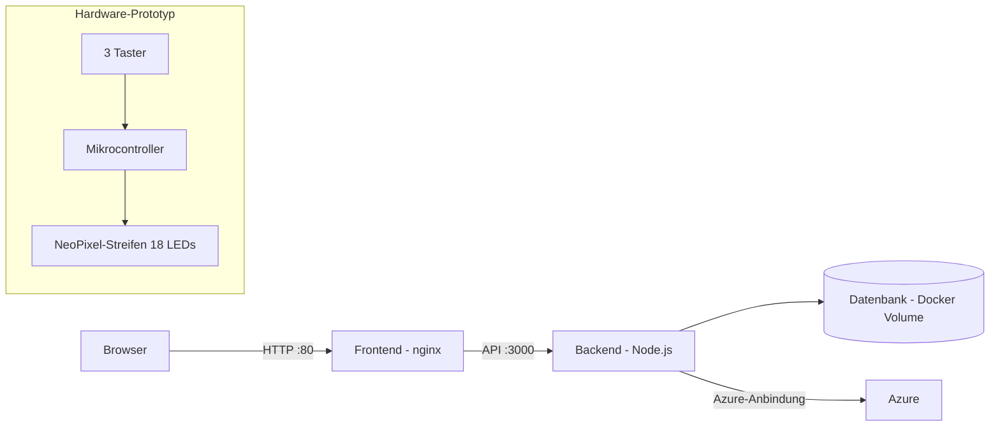

# LedShelf

Regalsystem mit LED-Beleuchtung: Webanwendung (Frontend + Backend) in Docker-Containern plus ein Hardware-Prototyp mit NeoPixel-LEDs und Tastern.
Entwickelt als Auftragsarbeit für eine Tischlerei, hier in bereinigter Form (ohne Kundendaten und Zugangsdaten) als Portfolio-Projekt.

<!-- TODO: 1-2 Sätze, was der Nutzer mit dem System konkret tut (z. B. Fächer ansteuern, Bestand verwalten). -->

## Screenshots

<!-- Bilder in docs/images/ ablegen und so einbinden. Vorher prüfen: keine Kundennamen, Preise oder personenbezogenen Daten sichtbar. -->

| Ansicht | Beschreibung |
|---|---|
|  | TODO |
|  | Prototyp mit LED-Reihen und Tastern |

## Architektur



Der Hardware-Prototyp ist im aktuellen Stand ein eigenständiger Arduino-Sketch. <!-- TODO: anpassen, falls er mit dem Backend kommuniziert. -->

## Technik

| Bereich | Umsetzung |
|---|---|
| Frontend | statische Auslieferung über nginx, Backend-URL wird beim Start in eine `config.json` geschrieben <!-- TODO: Framework --> |
| Backend | Node.js, Port 3000, Datenbank in einem Docker Volume <!-- TODO: Framework und DB --> |
| Betrieb | Docker Compose, Start über ein Skript, das die Host-IP ermittelt (Linux und Windows/Git Bash) |
| Hardware | Arduino mit Adafruit NeoPixel: 18 LEDs in 3 Reihen zu je 6, 3 Taster schalten die Reihen einzeln |

## Projektstruktur

```
.
├── backend/              Server
├── frontend/             Weboberfläche und nginx-Konfiguration
├── HardwareProjekt/      Arduino-Sketch und Aufbau
├── ESP_Praesentation/    Präsentationsunterlagen
├── scripts/              Hilfsskripte
├── patchNotes/           Änderungsverlauf
├── docker-compose.yml
└── .env.example          Vorlage für die Konfiguration (ohne Werte)
```

## Start

Voraussetzung: Docker mit Compose.

```bash
cp .env.example .env     # Werte eintragen, .env niemals committen
./StartDockerProdContainer.sh
```

Danach ist die Oberfläche unter `http://<Host-IP>` erreichbar, das Backend unter Port 3000.

## Konfiguration

Alle Zugangsdaten kommen über Umgebungsvariablen und stehen nicht im Repository:

| Variable | Zweck |
|---|---|
| `AZURE_CLIENT_ID` | Client-ID der Azure-App-Registrierung |
| `AZURE_TENANT_ID` | Verzeichnis (Tenant) |
| `AZURE_CLIENT_SECRET` | Secret der App-Registrierung |
| `AZURE_JSONWEB_TOKEN` | Schlüssel zum Signieren der Tokens |

## Hardware-Prototyp

- Mikrocontroller mit NeoPixel-Streifen an Pin 13 (18 LEDs)
- Taster an den Pins 2, 3 und 4, je einer pro Regalreihe
- Ein Tastendruck schaltet die zugehörige Reihe (6 LEDs, grün) an oder aus
- Bibliothek: `Adafruit_NeoPixel`

<!-- TODO: Foto und Schaltplan in docs/images/ ergänzen. -->

## Sicherheit

- Keine Zugangsdaten im Repository, Konfiguration über `.env` (in `.gitignore`).
- Startskript und Konfigurationsdateien mit Geheimnissen sind ausgeschlossen.
- Standard-Zugangsdaten für den Administrator sind nicht Teil dieser Dokumentation und werden beim ersten Start gesetzt. <!-- TODO: an die Realität anpassen -->

## Was ich daraus gelernt habe

<!-- TODO: 3-4 Stichpunkte, z. B. Container-Betrieb, Anbindung an Azure, Umgang mit Geheimnissen, Zusammenarbeit mit dem Kunden. -->
